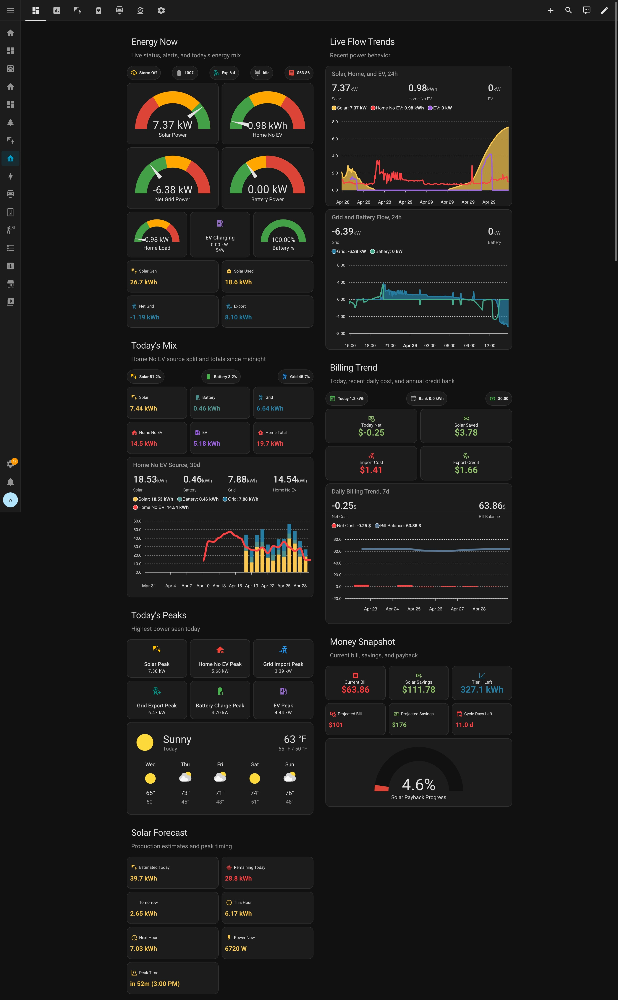

# Home Assistant Energy Insights

Reusable Home Assistant dashboards and YAML packages for solar, battery, grid, EV charging, billing, forecasting, and ROI tracking.

Energy Insights is built around a simple boundary: dashboards read stable canonical entities, and adapters map your real Home Assistant entities into that canonical model. That keeps the dashboard portable across different integrations while still allowing source-specific adapters for Tesla, Powerwall, chargers, inverters, and other energy systems.

## Screenshots

Additional dashboard screenshots live in [`docs/screenshots/`](docs/screenshots/).

- [Overview](docs/screenshots/energy-insights-overview.jpeg)
- [Analytics](docs/screenshots/energy-insights-analytics.jpeg)
- [Solar ROI](docs/screenshots/energy-insights-roi.jpeg)
- [EV](docs/screenshots/energy-insights-ev.jpeg)
- [Battery](docs/screenshots/energy-insights-battery.jpeg)
- [Forecasting](docs/screenshots/energy-insights-forecast.jpeg)
- [Config](docs/screenshots/energy-insights-config.jpeg)

## What's Included

- A full Lovelace dashboard bundle with `Overview`, `Analytics`, `Solar ROI`, `EV`, `Battery`, `Billing`, `Forecasting`, and `Config` views.
- Home Assistant packages for helpers, utility meters, derived sensors, billing math, credit tracking, forecasts, records, and payback calculations.
- A Tesla / Powerwall adapter example.
- Generic adapter templates for non-Tesla systems.
- Shared `button-card` templates and dashboard view files for maintainable editing.
- A Kubernetes deploy helper for testing against a Home Assistant dev pod.

## Requirements

- Home Assistant with YAML packages enabled.
- HACS or manually installed frontend cards:
  - Mushroom
  - ApexCharts Card
  - Button Card
- One adapter path that maps your source entities into the canonical entity names used by the dashboards.

## Quick Start

1. Install the required frontend cards.
2. Copy the package files from `packages/` into your Home Assistant `packages` directory.
3. Copy one adapter path from `adapters/`.
4. Edit adapter entity ids to match your Home Assistant instance.
5. Copy `dashboards/bundles/full-dashboard.yaml` into your Home Assistant dashboards directory.
6. Register the YAML dashboard in `configuration.yaml`.
7. Restart Home Assistant.

See the [Install Guide](docs/install.md) for the full setup flow.

## Adapter Model

Dashboards should not be edited for each home. Instead, adapters translate integration-specific entities into canonical entities such as:

- `sensor.home_solar_power`
- `sensor.home_load_power`
- `sensor.grid_import_daily`
- `sensor.ev_charging_power`
- `sensor.home_battery_percent`

For example, a Tesla / Powerwall install can use `adapters/tesla/`, while a different inverter or charger setup can start from `adapters/generic/`.

## Project Layout

- `adapters/` - source-specific mappings into canonical entities.
- `packages/helpers/` - user-configurable Home Assistant helpers.
- `packages/meters/` - utility meters for daily, billing, monthly, yearly, and true-up windows.
- `packages/core/` - source-agnostic calculations and derived sensors.
- `dashboards/views/` - editable dashboard views.
- `dashboards/templates/` - shared dashboard templates.
- `dashboards/bundles/` - install-ready dashboard bundles.
- `docs/` - install, adapter, and entity model documentation.
- `examples/` - reference install snippets and adapter examples.
- `docs/screenshots/` - public dashboard screenshots.

## Configuration Notes

- Billing rates, EV assumptions, battery capacity, ROI inputs, VPP values, and annual true-up reset behavior are configured from the dashboard's `Config` view.
- YAML helper definitions avoid fixed `initial` values where persistence matters, so changes made in Home Assistant are not reset on restart.
- Annual net-credit tracking is configurable. It can model utilities with a yearly true-up, but it is not hard-coded to one provider.
- Private or installation-specific adapter files should live outside committed public adapter files. For local development, `adapters/tesla-local/` is ignored by git and automatically used by the dev deploy script when present.

## Documentation

- [Install Guide](docs/install.md)
- [Entity Model](docs/entity-model.md)
- [Adapter Guide](docs/adapters.md)
- [Module Overview](docs/modules.md)
